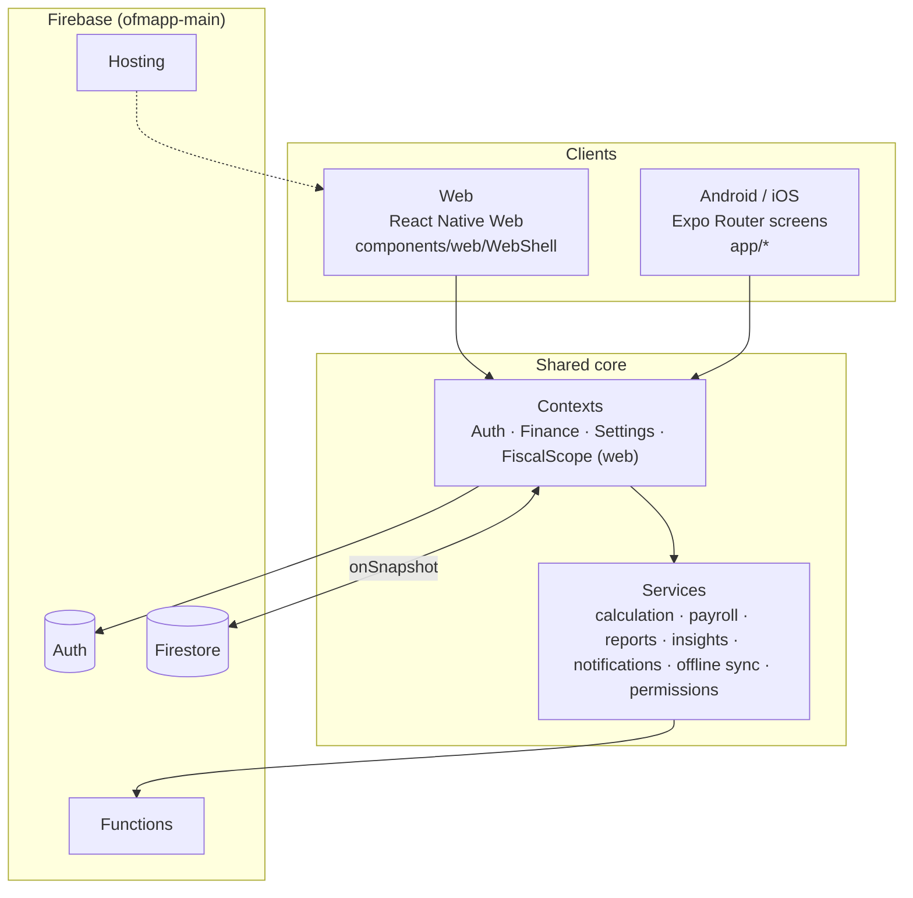

# OFM — System Architecture

OFM is a **client–serverless** system: one TypeScript/React Native codebase runs as a **web app** and as **Android/iOS apps**, and talks directly to **Google Firebase** (Authentication, Cloud Firestore, Cloud Functions, Hosting).

All diagrams: [docs/DIAGRAMS.md](docs/DIAGRAMS.md).

---

## 1. Overview

---

## 2. Technology

| Concern | Choice | Why |
|---|---|---|
| UI | React 19.3 + React Native 0.88 + React Native Web 0.21 | One component model for web and mobile |
| Platform | Expo SDK 58, Expo Router 58 | File-based routing, managed native modules, EAS builds |
| Language | TypeScript | Type safety across the shared code |
| Backend | Firebase Auth, Cloud Firestore, Cloud Functions | Real-time sync, no server to maintain |
| Hosting | Firebase Hosting | Global CDN, simple deploys |
| Charts / icons | react-native-svg | Same vector charts on web and mobile |
| Files | expo-print, expo-sharing, expo-file-system | PDF/CSV on phones |

---

## 3. Platform shells

### Web (`components/web/WebShell.tsx`)
- Dark sidebar with grouped navigation: **Overview** (Dashboard), **Finance** (Income, Expenses, Transactions, Budgets), **Organization** (Departments, Payroll, Team), **Insights** (Reports, AI Insights), **System** (Settings).
- Top bar: page title, **fiscal-year picker**, online status, notifications, theme toggle, profile.
- Below 768 px wide: compact header and bottom navigation (phone browsers).
- Role guard: `NAV_ITEMS.roleRestriction` + `allowedTabs` / `shownTab`; disallowed pages show a "no access" panel.
- `FiscalScopeProvider` re-provides `FinanceContext` filtered to the chosen fiscal year, so every page is scoped automatically.

### Mobile (`app/`)
- Expo Router. Bottom tabs in `app/(tabs)/`: **Dashboard, Income, Expenses, Reports, More**.
- Stack screens: `budget`, `departments`, `payroll`, `payslip-templates`, `team`, `settings`, `ai-insights`, `login`, `reset-password`, `onboarding`.
- **More** lists the same groups as the web sidebar with the same role rules.
- Components with a `.native.tsx` twin (e.g. `WebCashFlowBarChart.native.tsx`) are swapped in automatically on phones.

---

## 4. State layer (`context/`)

| Context | Holds | Live source |
|---|---|---|
| `AuthContext` | Current user, role, organization; login, Google login, sign-up, forgot password, logout | Firebase Auth + `users` |
| `FinanceContext` | transactions, budgets, payroll, departments, notifications, sync status; CRUD actions; computed totals | `onSnapshot` on `transactions`, `budgets`, `payroll`, `departments` (by `organizationId`) + notifications |
| `SettingsContext` | Company profile, currency, fiscal year, start month, theme | `onSnapshot` on `orgSettings/{orgId}` |
| `FiscalScopeProvider` (web) | Fiscal-year-filtered copy of FinanceContext | Derived |

---

## 5. Service layer (`services/`)

| Area | Files |
|---|---|
| Calculations | `FinancialCalculationEngine.ts`, `DatePeriodService.ts`, `fiscalYear.ts`, `cashFlowBarChart.ts` |
| Payroll | `PayrollCalculationEngine.ts`, `PayrollWorkflowService.ts`, `SalaryComponentService.ts`, `LoanService.ts` |
| Payslips | `payslipTemplate*.ts`, `PayslipTemplateService.ts`, `payslipPdfService.ts`, `payslipExportService.ts`, `payslipDocumentService.ts` |
| Reports & PDF | `ReportExportService.ts`, `reportDataService.ts`, `pdfDownloadService.ts`, `pdfService.ts`, `pdfTemplates/`, `craftMyPdfService.ts`, `pdfMonkeyService.ts`, `mobileWebPdfRedirectService.ts` |
| Insights | `financialInsightsService.ts`, `financialHealthService.ts` |
| Notifications | `notificationService.ts`, `notificationRules.ts`, `emailNotificationService.ts` |
| Sync | `offlineSyncService.ts`, `networkService.ts`, `firestoreRestService.ts` |
| Security | `permissionService.ts`, `auditService.ts`, `passwordResetClientService.ts` |
| Settings | `settingsHelper.ts` |

---

## 6. Backend (`functions/`, Firebase)

| Function | Type | Purpose |
|---|---|---|
| `generatePdfFromHtmlCallable`, `generatePdf` | callable | Server-side PDF generation |
| `forgotPasswordCallable`, `verifyResetTokenCallable`, `resetPasswordCallable` | callable | Password reset flow |
| `authApi` | HTTPS | Auth helper endpoints |

Data model: [docs/DATABASE.md](docs/DATABASE.md).

---

## 7. Cross-cutting design

| Concern | Approach |
|---|---|
| Consistency | Every screen uses `FinancialCalculationEngine` — web and mobile always match |
| Real-time | Firestore listeners; optimistic local updates |
| Offline | Local cache + outbox + tombstones; auto flush on reconnect ([DATA_FLOW.md](DATA_FLOW.md)) |
| Access control | `permissionService.can()`, navigation filters, page guards ([docs/ROLES_AND_PERMISSIONS.md](docs/ROLES_AND_PERMISSIONS.md)) |
| Theming | `hooks/useColors.ts` — shared accounting palette (light/dark) for web and mobile |
| Web polish | `components/web/animations/webStyles.ts` — font smoothing, tabular numbers, focus outlines |
| Responsiveness | `useWindowDimensions` breakpoints (768 px, 1024 px); `FitText` shrink-to-fit on web; `adjustsFontSizeToFit` on mobile |
| Errors | `ErrorBoundary`, tab-level error boundaries on web |

---

## 8. Known limitations

- Firestore rules are permissive (client-side role checks). Harden before production.
- Insights are rule-based.
- iOS tested via Expo Go only.
