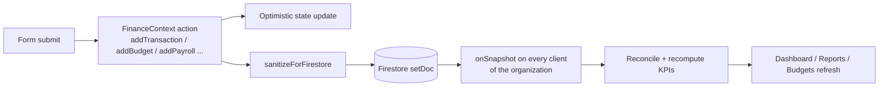
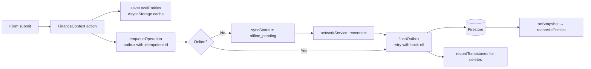
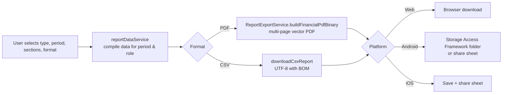

# OFM — Data Flow

How data moves through OFM. Sequence and DFD diagrams: [docs/DIAGRAMS.md](docs/DIAGRAMS.md) (§6–§14).

---

## 1. Single source of truth

Cloud Firestore is authoritative. Every record carries `organizationId`. Each client subscribes only to its own organization:

```ts
query(collection(db, "transactions"), where("organizationId", "==", orgId))
// same for budgets, payroll, departments
```

`FinanceContext` keeps the latest arrays in React state; every screen reads from there and calculates totals with `FinancialCalculationEngine`, so web and mobile always show identical numbers.

---

## 2. Write path (online)



---

## 3. Write path (offline, mobile)



- **Cold start:** cached entities are loaded first, so the app shows data immediately, even offline.
- **Tombstones:** ids of deleted records are remembered; if an old snapshot still contains them they are ignored and deleted again.
- **Empty-cache guard:** an empty snapshot that comes from cache while offline is ignored, so local data is never wiped.

---

## 4. Payroll → ledger

```mermaid
flowchart LR
  P[Save payroll entry] --> E[PayrollCalculationEngine<br/>net salary]
  E --> W[(payroll/{id})]
  W --> X[(transactions/{id}<br/>type expense · expenseSource payroll · payrollId)]
  X --> K[Expenses, budgets, dashboard 'Staff payroll' update]
```

Updating or reversing the payroll entry updates the linked expense, so the ledger never double-counts salaries.

---

## 5. Notifications

1. `syncLedgerNotificationEvents` evaluates rules (`notificationRules.ts`) whenever transactions, budgets, payroll or departments change.
2. Budget thresholds: **80 % warning, 90 % critical, 100 % over budget**.
3. Each notification has an idempotency key, so the same event is not posted twice.
4. `subscribeToNotifications(orgId, …, userId)` streams the organization's notifications to every member; read/removed state is kept per user.
5. Mobile registers a push token (`registerForPushNotificationsAsync`) for system notifications.

---

## 6. Settings and fiscal year

- `SettingsContext` listens to `orgSettings/{orgId}`; a change on any device updates currency, names and theme everywhere.
- Web: `FiscalScopeProvider` filters transactions by date, payroll by month and budgets by period to the chosen fiscal year (`services/fiscalYear.ts`, start month configurable). The choice is stored in `localStorage` (`ofm.web.fiscalScope`).

---

## 7. Reports



---

## 8. Authentication and organization membership

- Sign-in: Firebase Auth → `users/{uid}` profile (role, organizationId) → session persisted.
- Admin sign-up: creates the organization and the admin user.
- Joining: role and organization come from `invitations/{email}`; without an invitation, a valid admin e-mail as invite code joins as **Employee**.
- Sign-out on any device clears that device's session only.
