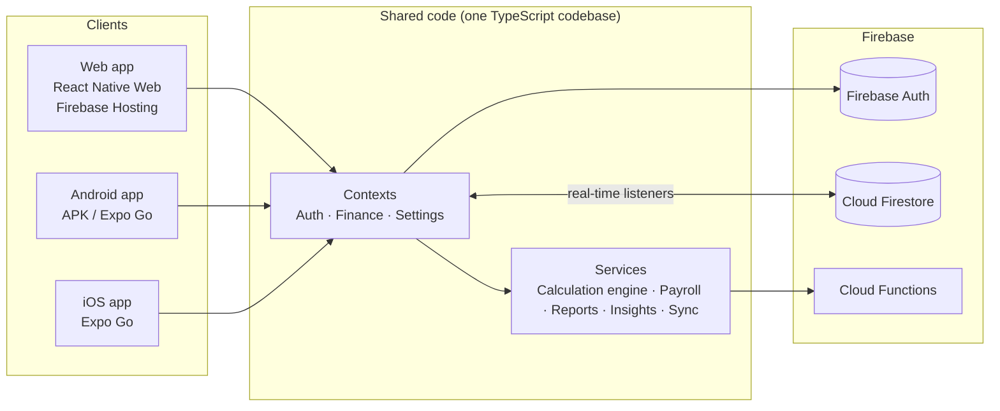

# OFM — Organization Finance Management

> One finance workspace for an organization — income, expenses, department budgets, payroll, payslips, reports and insights — on **Web, Android and iOS**, kept in sync in real time.

[](https://docs.expo.dev/)
[](https://reactnative.dev/)
[](https://firebase.google.com/)
[](https://ofmapp-main.web.app)

**Live web app:** https://ofmapp-main.web.app

---

## Documentation index

| Document | What it covers |
|---|---|
| **[docs/FYP_DOCUMENTATION.md](docs/FYP_DOCUMENTATION.md)** | Complete Final Year Project report: introduction, problem, objectives, scope, requirements, design, implementation, testing, conclusion |
| **[docs/DIAGRAMS.md](docs/DIAGRAMS.md)** | All diagrams: architecture, use case, ERD, class, sequence, activity, DFD (level 0/1), state, deployment, navigation |
| [ARCHITECTURE.md](ARCHITECTURE.md) | System architecture, layers, modules and design decisions |
| [DATA_FLOW.md](DATA_FLOW.md) | How data moves: real-time sync, offline outbox, payroll → expense, notifications, reports |
| [docs/DATABASE.md](docs/DATABASE.md) | Firestore collections, fields and relationships |
| [docs/ROLES_AND_PERMISSIONS.md](docs/ROLES_AND_PERMISSIONS.md) | Admin / Accountant / Manager / Employee access matrix |
| [docs/USER_GUIDE.md](docs/USER_GUIDE.md) | Step-by-step guide for every module (web and mobile) |
| [docs/TESTING.md](docs/TESTING.md) | Test strategy, the 17 automated suites and manual test cases |
| [PROJECT_STRUCTURE.md](PROJECT_STRUCTURE.md) | Folder-by-folder and file-by-file map of the codebase |
| [DEPLOYMENT.md](DEPLOYMENT.md) | Run locally, Expo Go, build the APK, deploy to Firebase Hosting |
| [CHANGELOG.md](CHANGELOG.md) | Version history |
| [CLEANUP.md](CLEANUP.md) | Log of earlier repository cleanup |

---

## What the system does

| Module | Main features |
|---|---|
| **Authentication** | Email/password sign-in and sign-up, Google sign-in, forgot/reset password, role chosen at sign-up, invite code (admin's email) to join an organization |
| **Dashboard** | Available cash card, overview cards (Income, Expenses, Budget, Transactions, Staff payroll), cash-flow bar chart and trend chart, budget / margin / spending donut analytics, top departments, recent transactions |
| **Income & Expenses** | Record, edit and delete income and expense transactions with category, department, date, payment method and reference |
| **Transactions** | Full ledger with search, type filter and date range |
| **Budgets** | Department budget lines, allocation vs spent, status (on track / near limit / over), filters |
| **Departments** | Department cards with head count, budget, spending and staff roster; one-click set-up for departments used in records but not yet created |
| **Payroll & Payslips** | Salary runs (base, bonus, deductions, net), payroll status workflow, automatic payroll expense in the ledger, payslip templates (editor, preview), PDF/PNG payslips |
| **Team** | Members list, role changes, invite by email, pending invites, duplicate-invite protection |
| **Reports** | Period summary, trend, analytics, department spending; export to **PDF** and **CSV** (web download, Android save-to-folder, iOS share sheet) |
| **AI Insights** | Rule-based financial health score, alerts (critical / advisories / positive), recommended actions, supporting charts |
| **Notifications** | Organization-wide notification centre, push notifications on mobile, budget and ledger alerts |
| **Settings** | Company profile, logo, currency, fiscal year and fiscal-year start month, theme (light/dark/system) |
| **Fiscal year** | Pick a fiscal year (or all time) on the web; every page is scoped to it |
| **Offline** | Mobile keeps working offline; changes queue in an outbox and sync when back online |

---

## Technology stack

| Layer | Technology |
|---|---|
| UI framework | React 19.3, React Native 0.88, React Native Web 0.21 |
| App platform | Expo SDK 58, Expo Router 58 (file-based routing) |
| Language | TypeScript |
| Charts & icons | react-native-svg (custom SVG charts, donut rings, bar chart, icon set) |
| Backend | Firebase Authentication, Cloud Firestore (real-time listeners), Cloud Functions |
| Hosting | Firebase Hosting (`ofmapp-main.web.app`) |
| Mobile builds | EAS Build (Android APK / AAB) |
| Files & sharing | expo-print, expo-sharing, expo-file-system (legacy API), Android Storage Access Framework |
| Local storage | AsyncStorage (mobile), localStorage / IndexedDB (web) |
| Notifications | expo-notifications (push), Firestore `notifications` collection |
| Testing | 17 TypeScript test suites run with `tsx` (`npm test`) |

---

## Quick start

```bash
# 1. Get the code
git clone https://github.com/devahmedaqeel/Organization-Finance-Management.git
cd Organization-Finance-Management

# 2. Install
npm install

# 3. Run (web + Expo Go QR code)
npm start            # press "w" for web, scan the QR with Expo Go (SDK 58)
```

Useful scripts:

| Command | Purpose |
|---|---|
| `npm start` | Start the Expo dev server (web + mobile) |
| `npm run web` | Open the web app only |
| `npm run typecheck` | TypeScript check (`tsc --noEmit`) |
| `npm test` | Run all 17 automated test suites |
| `npm run build:web` | Export the static web build to `dist/` |
| `npm run deploy:hosting` | Build web and deploy to Firebase Hosting |
| `npm run build:apk` | Build an installable Android APK with EAS |
| `npm run build:aab` | Build an Android App Bundle for the Play Store |

Full instructions: [DEPLOYMENT.md](DEPLOYMENT.md).

### Environment variables

The app reads Firebase settings from `EXPO_PUBLIC_*` variables (with project defaults in `config/firebase.ts`). Create `.env` for your own Firebase project:

```env
EXPO_PUBLIC_FIREBASE_API_KEY=...
EXPO_PUBLIC_FIREBASE_AUTH_DOMAIN=your-project.firebaseapp.com
EXPO_PUBLIC_FIREBASE_PROJECT_ID=your-project
EXPO_PUBLIC_FIREBASE_STORAGE_BUCKET=your-project.firebasestorage.app
EXPO_PUBLIC_FIREBASE_MESSAGING_SENDER_ID=...
EXPO_PUBLIC_FIREBASE_APP_ID=...
EXPO_PUBLIC_APP_URL=https://your-project.web.app
```

> Never commit real secrets. `.env` is git-ignored.

---

## High-level architecture



More diagrams: [docs/DIAGRAMS.md](docs/DIAGRAMS.md).

---

## Roles at a glance

| Role | Can do |
|---|---|
| **Admin** | Everything: team, roles, settings, budgets, payroll, transactions, reports, insights |
| **Accountant** | Income, expenses, budgets, payroll, payslip templates, reports, insights |
| **Manager** | View budgets, departments, payroll; approve payroll; reports and insights |
| **Employee** | Own payslips (and reports permission) |

Details: [docs/ROLES_AND_PERMISSIONS.md](docs/ROLES_AND_PERMISSIONS.md).

---

## Project status

- Web: deployed at https://ofmapp-main.web.app
- Android: APK built with EAS (`preview` profile)
- Expo SDK 58 · TypeScript clean (0 errors) · 17/17 test suites passing

## Author

Ahmed Aqeel — Final Year Project, Organization Finance Management (OFM).
