# OFM — System Diagrams

All diagrams are written in **Mermaid**, which GitHub renders automatically. To export them as images for a report, paste any block into https://mermaid.live and download PNG/SVG.

Contents

1. [System architecture](#1-system-architecture)
2. [Component (layer) diagram](#2-component-layer-diagram)
3. [Use case diagram](#3-use-case-diagram)
4. [Entity relationship diagram (ERD)](#4-entity-relationship-diagram-erd)
5. [Class diagram](#5-class-diagram)
6. [Data flow diagram — Level 0 (context)](#6-data-flow-diagram--level-0-context)
7. [Data flow diagram — Level 1](#7-data-flow-diagram--level-1)
8. [Sequence — Sign in](#8-sequence--sign-in)
9. [Sequence — Sign up and join an organization](#9-sequence--sign-up-and-join-an-organization)
10. [Sequence — Add a transaction and real-time sync (web ↔ mobile)](#10-sequence--add-a-transaction-and-real-time-sync-web--mobile)
11. [Sequence — Offline change and outbox sync](#11-sequence--offline-change-and-outbox-sync)
12. [Sequence — Run payroll](#12-sequence--run-payroll)
13. [Sequence — Export a report (PDF / CSV)](#13-sequence--export-a-report-pdf--csv)
14. [Sequence — Invite a team member](#14-sequence--invite-a-team-member)
15. [Activity — Payroll run](#15-activity--payroll-run)
16. [Activity — Budget check when an expense is recorded](#16-activity--budget-check-when-an-expense-is-recorded)
17. [State — Payroll entry](#17-state--payroll-entry)
18. [State — Invitation](#18-state--invitation)
19. [Deployment diagram](#19-deployment-diagram)
20. [Navigation map (web and mobile)](#20-navigation-map-web-and-mobile)
21. [Role-based access flow](#21-role-based-access-flow)

---

## 1. System architecture

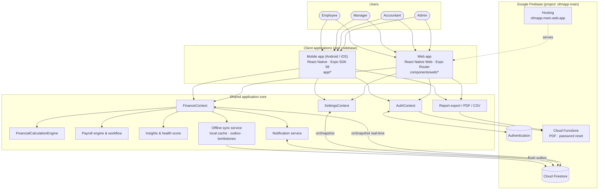

---

## 2. Component (layer) diagram

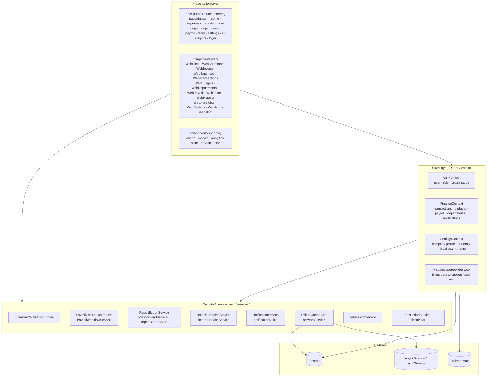

---

## 3. Use case diagram

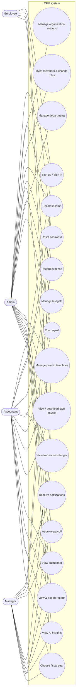

---

## 4. Entity relationship diagram (ERD)

All business records carry `organizationId`; that is how data is separated per organization.

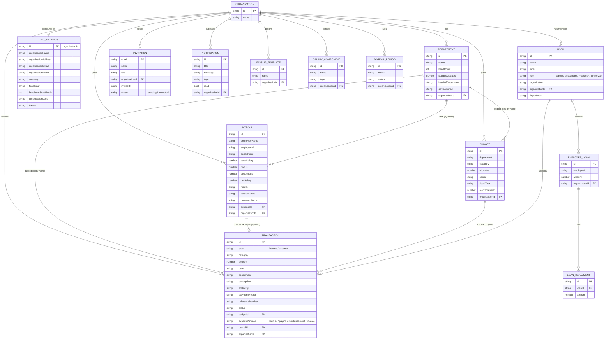

---

## 5. Class diagram

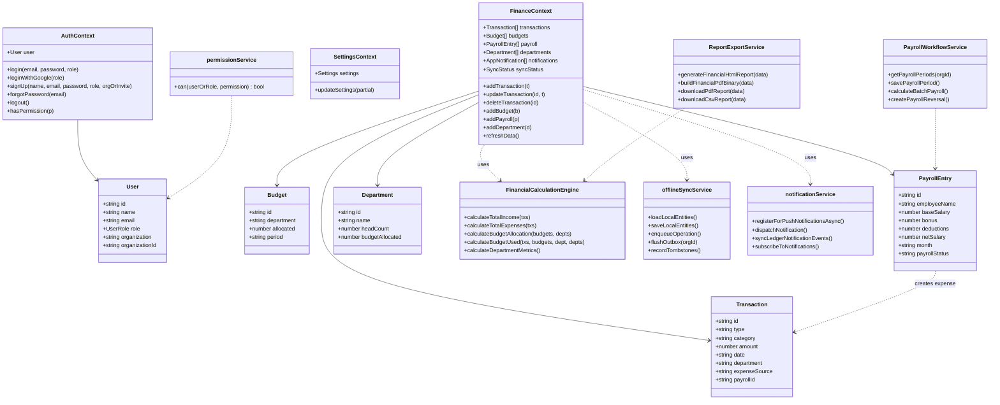

---

## 6. Data flow diagram — Level 0 (context)

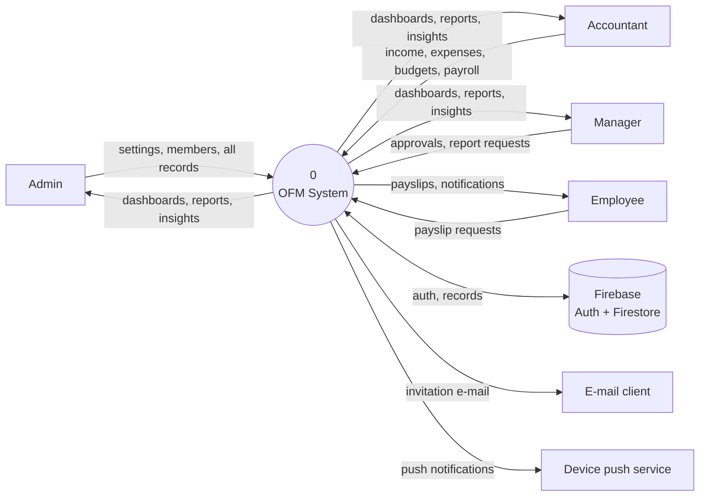

---

## 7. Data flow diagram — Level 1

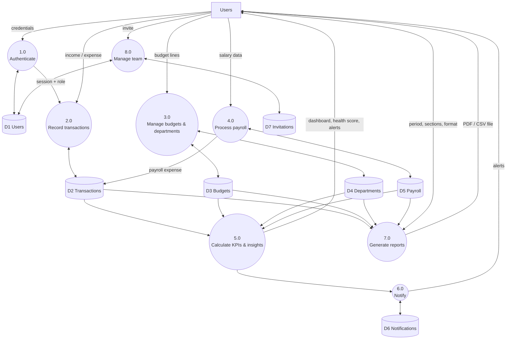

---

## 8. Sequence — Sign in

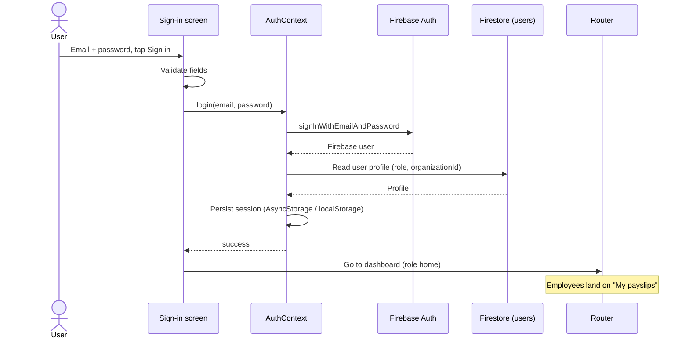

---

## 9. Sequence — Sign up and join an organization

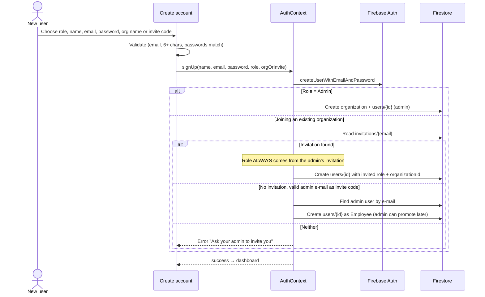

---

## 10. Sequence — Add a transaction and real-time sync (web ↔ mobile)

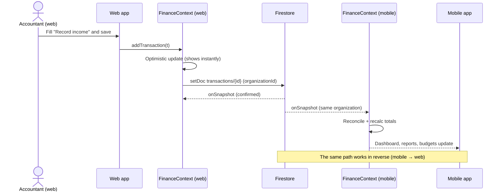

---

## 11. Sequence — Offline change and outbox sync

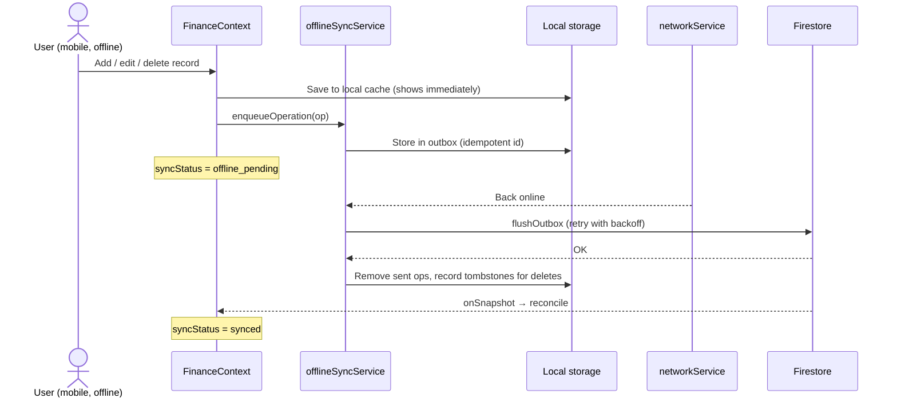

---

## 12. Sequence — Run payroll

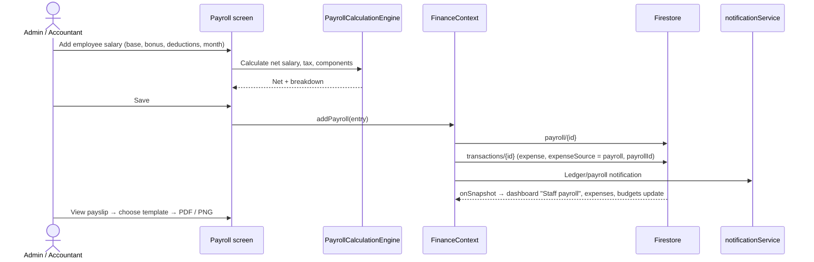

---

## 13. Sequence — Export a report (PDF / CSV)

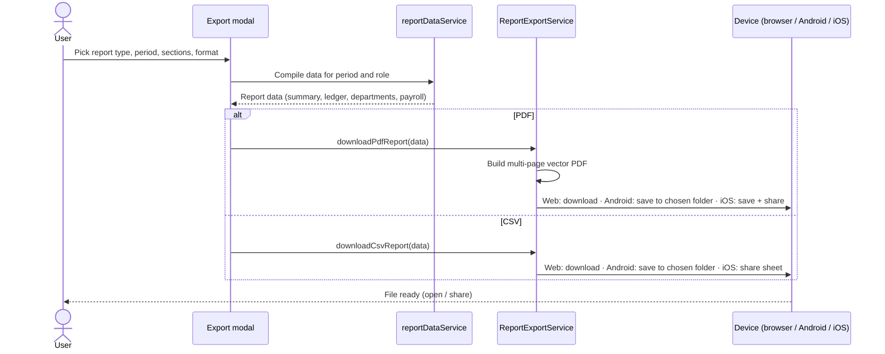

---

## 14. Sequence — Invite a team member

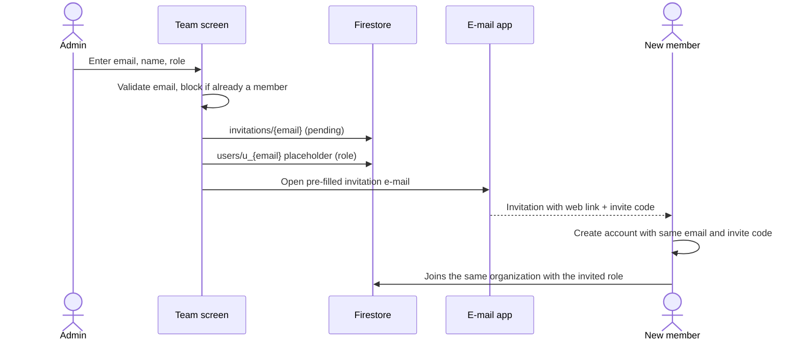

---

## 15. Activity — Payroll run

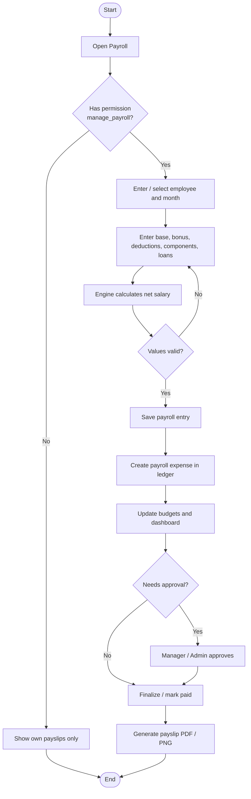

---

## 16. Activity — Budget check when an expense is recorded

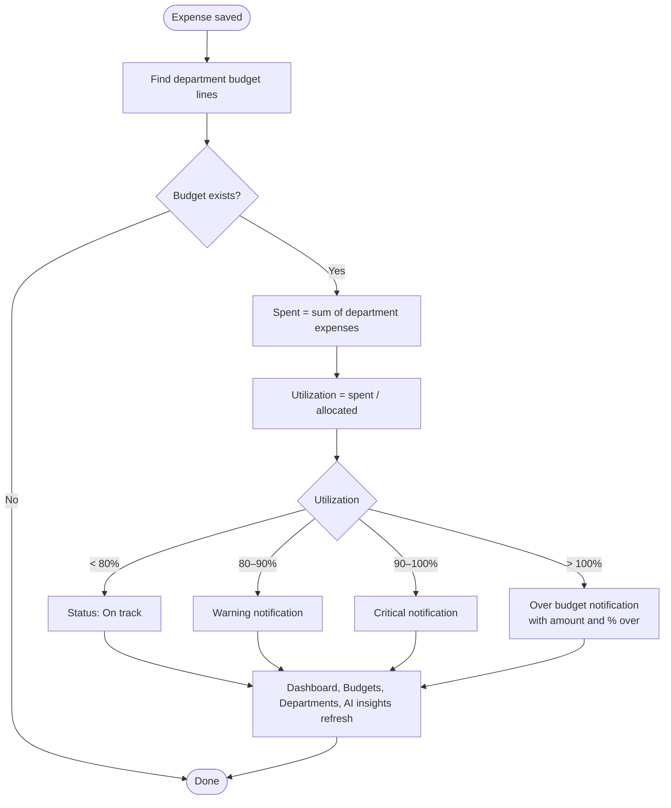

---

## 17. State — Payroll entry

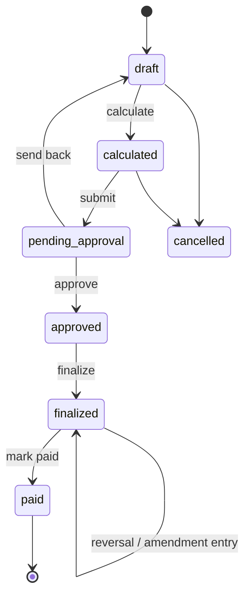

---

## 18. State — Invitation

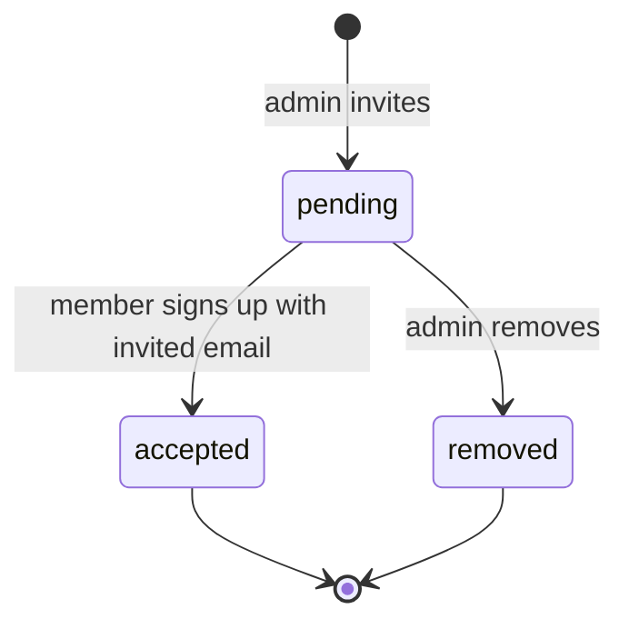

---

## 19. Deployment diagram

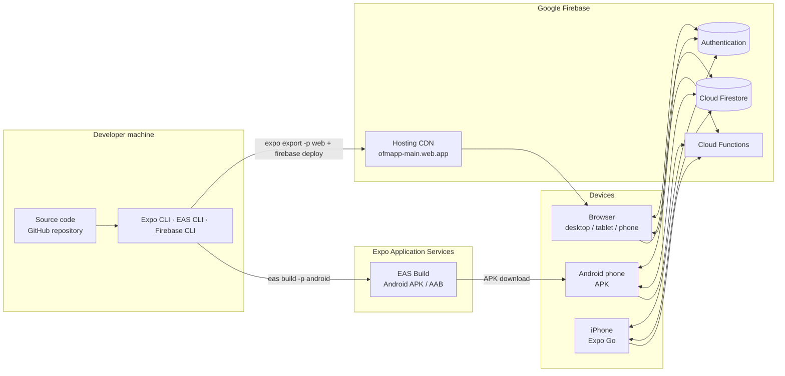

---

## 20. Navigation map (web and mobile)

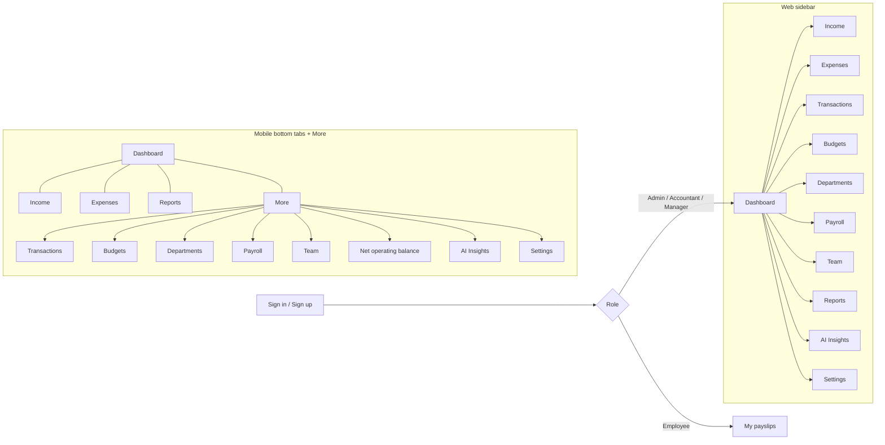

---

## 21. Role-based access flow

```mermaid
flowchart TD
  A[User opens a page] --> B[Read role from AuthContext]
  B --> C{"Page allowed for role?<br/>(NAV_ITEMS roleRestriction /<br/>permissionService.can)"}
  C -- Yes --> D[Render page]
  C -- No, default page --> E[Redirect to role home<br/>Dashboard or My payslips]
  C -- No, direct link --> F["Show 'You don't have access' panel<br/>with button to home"]
  D --> G{Action needs permission?<br/>e.g. delete_transaction}
  G -- Yes, allowed --> H[Show button / perform action]
  G -- Not allowed --> I[Hide button]
```
