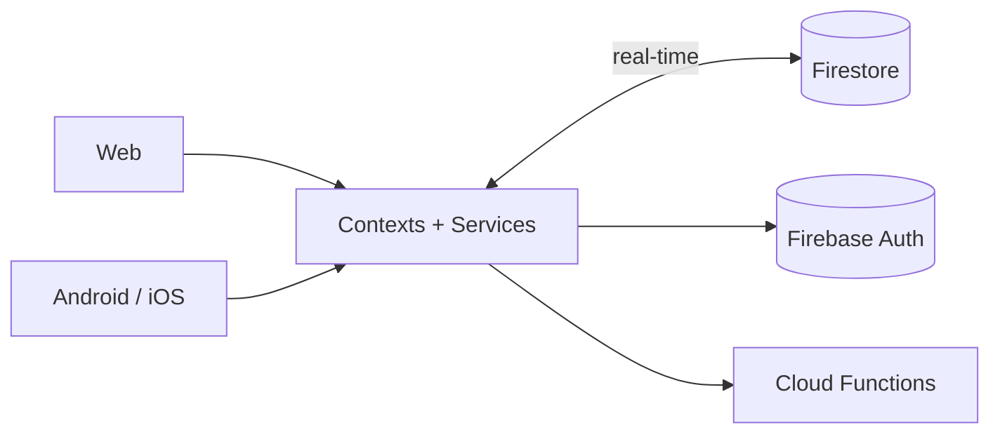

# OFM — Organization Finance Management
## Final Year Project Documentation

| | |
|---|---|
| **Project title** | OFM — Organization Finance Management (Web + Mobile) |
| **Developer** | Ahmed Aqeel |
| **Platforms** | Web (desktop, tablet, phone browser), Android, iOS |
| **Live system** | https://ofmapp-main.web.app |
| **Repository** | https://github.com/devahmedaqeel/Organization-Finance-Management |
| **Version** | 1.0.3 (Expo SDK 58) |

> Diagrams referenced in this report are in **[DIAGRAMS.md](DIAGRAMS.md)** (Mermaid source — export to PNG via https://mermaid.live).

---

## Table of contents

1. [Introduction](#1-introduction)
2. [Problem statement](#2-problem-statement)
3. [Objectives](#3-objectives)
4. [Scope](#4-scope)
5. [Literature review / existing systems](#5-literature-review--existing-systems)
6. [Methodology](#6-methodology)
7. [Requirements specification](#7-requirements-specification)
8. [System design](#8-system-design)
9. [Database design](#9-database-design)
10. [Module design and implementation](#10-module-design-and-implementation)
11. [User interface design](#11-user-interface-design)
12. [Security and access control](#12-security-and-access-control)
13. [Synchronization and offline design](#13-synchronization-and-offline-design)
14. [Testing](#14-testing)
15. [Deployment](#15-deployment)
16. [Results](#16-results)
17. [Limitations](#17-limitations)
18. [Future work](#18-future-work)
19. [Conclusion](#19-conclusion)
20. [References](#20-references)
21. [Appendix A — Glossary](#appendix-a--glossary)
22. [Appendix B — Project file map](#appendix-b--project-file-map)

---

## 1. Introduction

Small and medium organizations (companies, schools, NGOs, departments of universities) often manage money in spreadsheets, paper registers and separate payroll tools. Information is scattered, totals disagree, managers cannot see spending until month-end, and staff cannot get their payslips without asking the accounts office.

**OFM (Organization Finance Management)** is a cross-platform finance system that keeps an organization's income, expenses, department budgets, payroll, payslips, reports and alerts in **one shared, real-time database**, accessible from a web browser and from Android/iOS phones. Each person sees only what their role allows.

The system is built from **one TypeScript codebase** (React Native + Expo) that runs as a website and as a mobile app, with **Google Firebase** as the backend (authentication, real-time database, hosting and cloud functions).

---

## 2. Problem statement

1. **Scattered records** — income, expenses, budgets and salaries live in different files, so totals don't match.
2. **No real-time visibility** — managers learn about overspending only after the fact.
3. **Manual payroll and payslips** — salary calculation and payslip preparation are slow and error-prone.
4. **No access control** — everyone with the spreadsheet can see salaries and edit numbers.
5. **No mobile access** — staff and managers cannot check figures or payslips on the move.
6. **Reporting effort** — building monthly/annual reports by hand takes days.

---

## 3. Objectives

| # | Objective | How OFM meets it |
|---|---|---|
| O1 | Single source of truth for all financial records | Cloud Firestore, every record tagged with `organizationId` |
| O2 | Real-time updates across web and mobile | Firestore `onSnapshot` listeners in `FinanceContext` |
| O3 | Department budgeting with alerts | Budget lines, utilization, 80/90/100% notifications |
| O4 | Automated payroll and professional payslips | Payroll engine, status workflow, template editor, PDF/PNG export |
| O5 | Role-based access (Admin, Accountant, Manager, Employee) | `permissionService`, page guards, role-specific navigation |
| O6 | One-click reports | PDF and CSV export for any period and section |
| O7 | Insight into financial health | Health score, rule-based alerts and recommendations |
| O8 | Work without internet on mobile | Local cache, offline outbox, tombstones, automatic sync |
| O9 | Professional, easy UI | Accounting-style design shared by web and mobile |

---

## 4. Scope

**In scope**

- Organization sign-up, member invitation and role management
- Income and expense ledger with categories, departments, payment method, reference
- Department management and budget planning
- Payroll entries, payroll workflow, payroll expense posting, payslip templates and exports
- Dashboard, reports (PDF/CSV), AI-style insights, notifications
- Fiscal year selection and start month
- Web (Firebase Hosting) and Android (APK); iOS via Expo Go

**Out of scope**

- Bank integration / automatic bank feeds
- Tax filing with government portals
- Multi-currency conversion inside one organization (one currency per organization)
- Machine-learning forecasting (insights are rule-based)

---

## 5. Literature review / existing systems

| System | Strengths | Gaps OFM addresses |
|---|---|---|
| Spreadsheets (Excel / Google Sheets) | Flexible, familiar | No roles, no real-time alerts, easy to break formulas, no payslips |
| QuickBooks / Xero | Full accounting | Costly subscriptions, complex for small organizations, payroll localisation limited |
| Standalone payroll tools | Payslips | Not linked to the ledger or budgets |
| Paper registers | No technology needed | No reporting, no backup, no access control |

OFM borrows the clean accounting look of tools like QuickBooks (green/red income–expense colours, cards, tables) while keeping the feature set focused on organizational budgeting and payroll.

---

## 6. Methodology

- **Model:** Iterative / Agile — features delivered in short cycles (auth → ledger → budgets → payroll → reports → insights → sync → UI refinement), each followed by testing and feedback.
- **Tools:** VS Code, Expo CLI, EAS CLI, Firebase CLI, Git & GitHub, Mermaid for diagrams.
- **Quality gates for each change:** `npm run typecheck` (0 errors), `npm test` (17/17 suites), bundle build for Android, iOS and web.

---

## 7. Requirements specification

### 7.1 Stakeholders / actors

| Actor | Description |
|---|---|
| Admin | Creates the organization; full control |
| Accountant | Day-to-day bookkeeping and payroll |
| Manager | Monitors budgets and reports; approves payroll |
| Employee | Views own payslips |
| Firebase | External backend (auth, database, hosting, functions) |

### 7.2 Functional requirements

| ID | Requirement |
|---|---|
| FR-01 | The system shall let a user create an account with name, email, password and role. |
| FR-02 | An Admin sign-up shall create a new organization. |
| FR-03 | A non-admin shall join an organization using an invitation; the role shall come from the invitation. |
| FR-04 | Users shall sign in with email/password or Google. |
| FR-05 | Users shall reset a forgotten password by email. |
| FR-06 | Admin shall invite members by email and change their roles; duplicate invites shall be blocked. |
| FR-07 | Authorized users shall record, edit and delete income and expense transactions. |
| FR-08 | The system shall show a ledger with search, type filter and date range. |
| FR-09 | Authorized users shall create departments and budget lines. |
| FR-10 | The system shall calculate budget utilization and raise warning (80%), critical (90%) and over-budget (100%) notifications. |
| FR-11 | Authorized users shall create payroll entries; net salary shall be calculated automatically. |
| FR-12 | Saving payroll shall post a matching expense to the ledger. |
| FR-13 | Payroll shall follow a status workflow (draft → calculated → pending approval → approved → finalized → paid). |
| FR-14 | Users shall generate payslips from editable templates as PDF/PNG. |
| FR-15 | Employees shall view and download only their own payslips. |
| FR-16 | The dashboard shall show available cash, income, expenses, budget, transactions, payroll, cash-flow charts and analytics. |
| FR-17 | Users shall export reports for a chosen period as PDF or CSV. |
| FR-18 | The system shall compute a financial health score and actionable insights. |
| FR-19 | All members shall receive organization notifications (in-app and push on mobile). |
| FR-20 | Admin shall edit company profile, logo, currency, fiscal year, fiscal-year start month and theme. |
| FR-21 | Users shall scope the web app to a chosen fiscal year. |
| FR-22 | Changes made on web shall appear on mobile and vice versa without refresh. |
| FR-23 | The mobile app shall work offline and sync queued changes when online. |
| FR-24 | Pages and actions shall be restricted by role. |

### 7.3 Non-functional requirements

| ID | Category | Requirement |
|---|---|---|
| NFR-01 | Usability | Consistent accounting-style UI on web and mobile; text readable at phone sizes; one-line tables with shrink-to-fit |
| NFR-02 | Performance | Dashboard updates within ~1 s of a Firestore change; Android bundle builds in < 20 s in development |
| NFR-03 | Availability | Web served from Firebase Hosting global CDN |
| NFR-04 | Reliability | Offline outbox with retry; tombstones prevent deleted records from reappearing |
| NFR-05 | Security | Firebase Authentication; role checks in UI; data isolated by `organizationId` |
| NFR-06 | Portability | One codebase for web, Android, iOS |
| NFR-07 | Maintainability | TypeScript, layered services, 17 automated test suites |
| NFR-08 | Accuracy | Single calculation engine used by every screen; exact (unrounded) money values |

---

## 8. System design

### 8.1 Architecture

OFM uses a **client–serverless architecture**:

- **Clients:** Web (React Native Web, served by Firebase Hosting) and Mobile (React Native via Expo).
- **Application core (shared):** React Contexts hold state; services hold business logic.
- **Backend:** Firebase Authentication, Cloud Firestore (real-time document database) and Cloud Functions (PDF generation, password reset).

See **DIAGRAMS.md §1 System architecture** and **§2 Component diagram**.

### 8.2 Layers

| Layer | Contents | Responsibility |
|---|---|---|
| Presentation | `app/` (mobile screens & routes), `components/web/` (web pages), `components/` (shared UI) | Display data, collect input |
| State | `AuthContext`, `FinanceContext`, `SettingsContext`, `FiscalScopeProvider` | Hold current user, organization data and settings; subscribe to Firestore |
| Domain | `services/` | Calculations, payroll, reports, insights, notifications, sync, permissions |
| Data | Firestore, Firebase Auth, AsyncStorage/localStorage | Persistence |

### 8.3 Key design decisions

1. **One codebase, two shells.** Mobile uses Expo Router screens in `app/`; the web renders `components/web/WebShell.tsx` with a sidebar and dedicated pages. Both use the same contexts and services, so numbers always match.
2. **Single calculation engine.** `FinancialCalculationEngine.ts` is the only place totals, budget usage and department metrics are computed.
3. **Real-time first.** Firestore listeners push changes to every open client in the organization.
4. **Offline first on mobile.** Writes go to a local cache and an outbox first, then to Firestore.
5. **Role guard in two places.** Navigation hides pages a role cannot use, and page guards block direct links.

### 8.4 Diagrams

| Diagram | Section in DIAGRAMS.md |
|---|---|
| Use case | §3 |
| ERD | §4 |
| Class | §5 |
| DFD Level 0 / Level 1 | §6, §7 |
| Sequence (sign-in, sign-up, sync, offline, payroll, export, invite) | §8–§14 |
| Activity (payroll, budget check) | §15, §16 |
| State (payroll, invitation) | §17, §18 |
| Deployment | §19 |
| Navigation | §20 |
| Role-based access | §21 |

---

## 9. Database design

Cloud Firestore (NoSQL, document-based). Every business document stores `organizationId`, which isolates organizations from each other.

| Collection | Purpose |
|---|---|
| `users` | Member profile: name, email, role, organization, organizationId |
| `organizations` | Organization record |
| `orgSettings` | Company profile, currency, fiscal year, start month, logo, theme |
| `invitations` | Pending invitations keyed by email |
| `transactions` | Income and expense ledger |
| `budgets` | Department budget lines |
| `departments` | Department records |
| `payroll` | Payroll entries |
| `payrollPeriods` | Payroll run periods and approval status |
| `salaryComponents` | Allowance / deduction definitions |
| `employeeLoans`, `loanRepayments` | Staff loans and repayments |
| `payslipTemplates`, `payslipTemplateSettings` | Payslip designs and defaults |
| `notifications` | Organization notifications |
| `auditLogs`, `email_audit_logs` | Activity and e-mail audit trail |
| `tombstones` | Deleted record ids (prevents resurrection after offline sync) |

Full field list and relationships: **[DATABASE.md](DATABASE.md)**; ERD: **DIAGRAMS.md §4**.

---

## 10. Module design and implementation

### 10.1 Authentication (`context/AuthContext.tsx`, `components/web/WebAuth.tsx`, `app/login.tsx`)
Email/password and Google sign-in via Firebase Auth. Sign-up creates a new organization (Admin) or joins one through an invitation. Sessions persist in AsyncStorage (mobile) or browser storage (web). Password reset uses Cloud Functions.

### 10.2 Dashboard (`components/web/WebDashboard.tsx`, `app/(tabs)/index.tsx`)
Available-cash card with Net cash / Spending views and breakdown; five overview cards; cash-flow bar chart (`WebCashFlowBarChart` with a native version for phones) and trend chart; analytics suite with Budget, Margin and Spending donut rings (`components/analytics/FinancialAnalyticsSuite.tsx`); top departments; recent transactions.

### 10.3 Income, expenses and transactions
Forms validate amount, category, department and date. The ledger supports search, filters and date range. Deleting is permission-checked (`delete_transaction`).

### 10.4 Budgets and departments
Budget lines per department and period. Totals use `calculateBudgetAllocation` and `calculateBudgetUsed`. Departments referenced by records but never created are detected and can be set up with one click.

### 10.5 Payroll and payslips
`PayrollCalculationEngine` computes net salary, tax and components; `PayrollWorkflowService` handles periods, approval and reversals. Saving payroll posts an expense (`expenseSource: "payroll"`, `payrollId`). Payslips use editable templates (`components/payslip/*`, `services/payslipTemplate*.ts`) and export as PDF/PNG.

### 10.6 Team
Lists members, changes roles, invites by email (writes `invitations` and a placeholder user, opens a pre-filled e-mail), and blocks inviting someone who is already a member.

### 10.7 Reports
`reportDataService` compiles the selected period and sections; `ReportExportService` builds a multi-page vector PDF or a CSV. Web downloads the file; Android saves to a folder chosen via the Storage Access Framework; iOS opens the share sheet.

### 10.8 AI insights
`financialInsightsService` and `financialHealthService` produce a 0–100 health score and insights grouped as critical, advisories and positive, each with "why it matters" and a recommended action. Insights are deterministic and rule-based.

### 10.9 Notifications
`notificationService` writes organization notifications, subscribes all members in real time, registers mobile push tokens and evaluates ledger rules (`notificationRules.ts`) with idempotency keys to avoid duplicates.

### 10.10 Settings and fiscal year
Company profile, logo, currency, theme, fiscal year and fiscal-year start month (`services/fiscalYear.ts`). On the web, `FiscalScopeProvider` filters every page to the chosen fiscal year.

---

## 11. User interface design

- **Design language:** accounting-style — neutral grey surfaces, white cards, green brand (#2CA01C), income green (#108000), expense red (#D52B1E), info blue (#0077C5); shared palette in `hooks/useColors.ts` for web and mobile.
- **Typography:** Inter; normal weights (600 for headings), compact sizes on mobile.
- **Web layout:** dark sidebar with grouped navigation (Overview, Finance, Organization, Insights, System), top bar with fiscal-year picker, online status, notifications, theme and profile.
- **Mobile layout:** bottom tabs (Dashboard, Income, Expenses, Reports, More); More is a grouped list matching the web sidebar.
- **Charts:** custom SVG (react-native-svg): animated donut rings, side-by-side income/expense bars, trend area chart, horizontal bars.
- **Readability:** long text wraps or shrinks to fit (`FitText` on web, `adjustsFontSizeToFit` on mobile).
- **Branding:** OFM logo (green tile with rising bars and trend arrow) used for web favicon, sign-in screens and the app icon.

---

## 12. Security and access control

| Control | Implementation |
|---|---|
| Authentication | Firebase Auth (email/password, Google) |
| Authorization | `services/permissionService.ts` — 26 permissions mapped to 4 roles |
| Navigation guard | Web `NAV_ITEMS.roleRestriction` + page guard; mobile `useRequirePermission` and filtered More menu |
| Data isolation | Every query filters by `organizationId` |
| Role on join | Taken from the admin's invitation, not chosen by the joining user |
| Sensitive payroll | `view_sensitive_payroll_data` only for Admin and Accountant |

Role matrix: **[ROLES_AND_PERMISSIONS.md](ROLES_AND_PERMISSIONS.md)**.

> **Known gap:** the current Firestore security rules allow public reads on several collections. Role checks are enforced in the app, not yet in database rules. See §17.

---

## 13. Synchronization and offline design

- **Real-time:** `FinanceContext` subscribes with `onSnapshot` to `transactions`, `budgets`, `payroll`, `departments` (filtered by `organizationId`); `SettingsContext` subscribes to `orgSettings`; notifications are subscribed per user. A change on any device reaches all other devices of the organization within about a second.
- **Offline (mobile):** `offlineSyncService` keeps a local cache per organization, an outbox of pending operations (idempotent ids, exponential back-off), and tombstones for deletions. `networkService` triggers `flushOutbox` when the device reconnects. `syncStatus` shows *synced / syncing / offline pending / error*.

Sequences: **DIAGRAMS.md §10 and §11**. Details: **[../DATA_FLOW.md](../DATA_FLOW.md)**.

---

## 14. Testing

| Level | Approach | Result |
|---|---|---|
| Static | `npm run typecheck` (TypeScript strict compile) | 0 errors |
| Unit / integration | 17 automated suites (`npm test`) covering calculations, payroll, payslips, reports, insights, offline sync, cross-platform parity, password reset | 17/17 passing |
| Build | Android, iOS and web bundles built from the dev server | All build without errors |
| Manual | Role-based access, module walkthroughs on web and Expo Go | See [TESTING.md](TESTING.md) |

Full test plan and cases: **[TESTING.md](TESTING.md)**.

---

## 15. Deployment

| Target | Method |
|---|---|
| Web | `npx expo export -p web` → `firebase deploy --only hosting` → https://ofmapp-main.web.app |
| Android | `eas build -p android --profile preview` → installable APK |
| iOS (testing) | Expo Go (SDK 58) via `npx expo start` |
| Backend | Firebase project `ofmapp-main` (Auth, Firestore, Functions) |

Step-by-step: **[../DEPLOYMENT.md](../DEPLOYMENT.md)**; diagram: **DIAGRAMS.md §19**.

---

## 16. Results

- Working web application deployed on Firebase Hosting.
- Android APK built with EAS; mobile app runs in Expo Go (SDK 58).
- Web and mobile share data in real time for the same organization.
- Four roles with distinct navigation and permissions.
- Automated payroll posting to the ledger, budget alerts and organization notifications.
- PDF and CSV reports downloadable on web, Android and iOS.
- TypeScript compile clean; 17/17 automated test suites pass.

*(Add screenshots of the Dashboard, Budgets, Payroll, Reports, AI Insights and mobile screens here in your printed report.)*

---

## 17. Limitations

1. **Firestore rules are permissive** — several collections allow public reads; role checks are enforced in the client. Production use needs stricter rules (organization membership and role checks in `firestore.rules`).
2. **Insights are rule-based**, not machine-learning predictions.
3. **iOS** is tested through Expo Go; a standalone iOS build needs an Apple developer account.
4. **Single currency** per organization; no exchange-rate handling.
5. **No bank integration** — transactions are entered manually.
6. Invitation e-mails open the user's own mail app instead of being sent by a server.

---

## 18. Future work

- Harden Firestore security rules with role- and organization-based checks.
- Server-side invitation e-mails and approval workflows (Cloud Functions).
- Bank statement import (CSV/OFX) and reconciliation.
- Forecasting of cash flow and budget burn using time-series models.
- Multi-currency with exchange rates.
- Standalone iOS release and Play Store publishing (AAB build profile is ready).
- Audit log viewer for admins.

---

## 19. Conclusion

OFM brings an organization's income, expenses, budgets, payroll and reporting into one real-time, role-based system that works the same on the web and on phones. Using a single TypeScript codebase with Expo and Firebase kept development fast and guaranteed that every platform shows identical figures. The project meets its objectives of centralised records, live visibility, automated payroll and payslips, controlled access and easy reporting, and provides a solid base for the security and automation improvements listed above.

---

## 20. References

1. Expo documentation — https://docs.expo.dev/
2. React Native — https://reactnative.dev/
3. React Native for Web — https://necolas.github.io/react-native-web/
4. Firebase documentation (Auth, Firestore, Hosting, Functions) — https://firebase.google.com/docs
5. Expo Router — https://docs.expo.dev/router/introduction/
6. EAS Build — https://docs.expo.dev/build/introduction/
7. react-native-svg — https://github.com/software-mansion/react-native-svg
8. Mermaid diagrams — https://mermaid.js.org/

---

## Appendix A — Glossary

| Term | Meaning |
|---|---|
| Ledger | List of all income and expense transactions |
| Budget line | Planned amount for a department (and category) in a period |
| Utilization | Spent ÷ allocated, as a percentage |
| Net operating balance | Income − expenses |
| Fiscal year | 12-month accounting year (start month configurable, default July) |
| Outbox | Local queue of changes waiting to be sent to the server |
| Tombstone | Record that an item was deleted, so it is not restored by an old copy |
| Organization ID | Identifier that separates one organization's data from another's |

## Appendix B — Project file map

See **[../PROJECT_STRUCTURE.md](../PROJECT_STRUCTURE.md)**.
